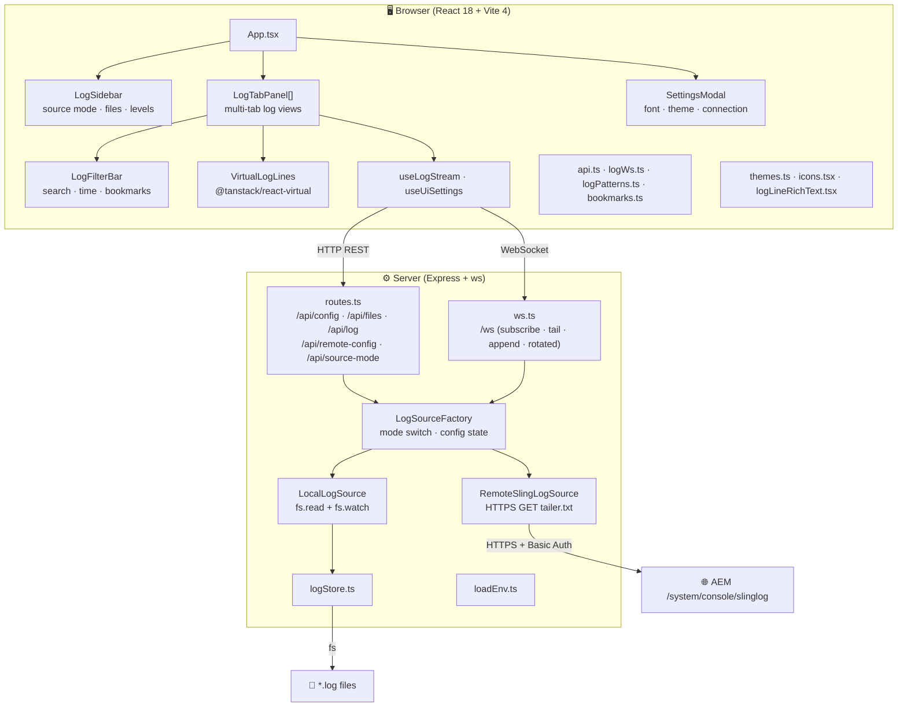
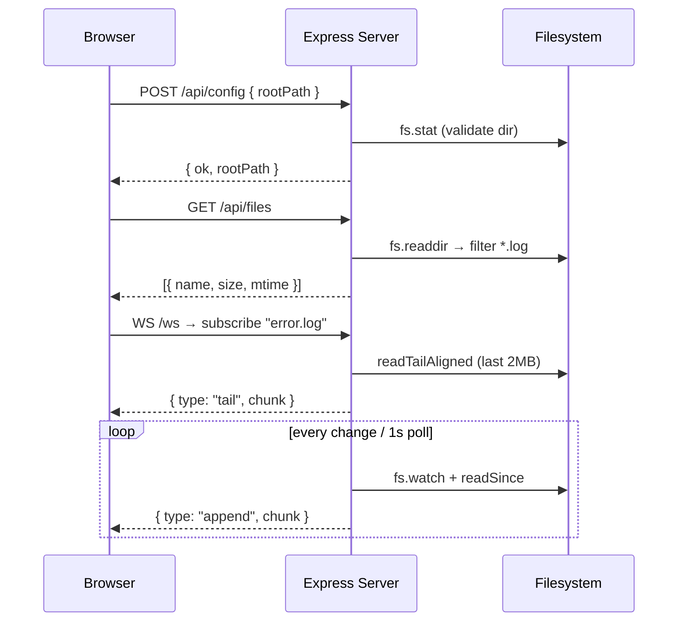
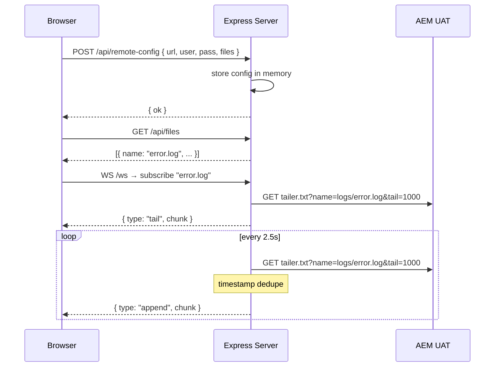
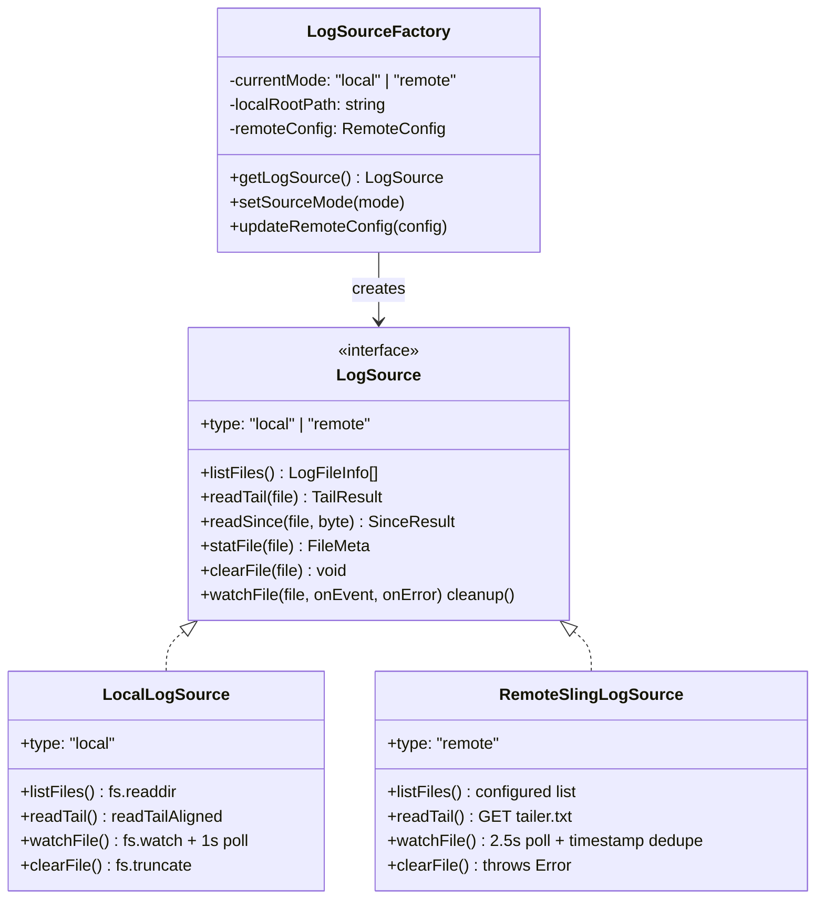

# Slingtail

> A modern, minimal, real-time log viewer for Apache Sling and AEM. Tail local files or stream remote instances via `tailer.txt`.

[GitHub](https://github.com/thnhan1/sling-log-viewer)

## Quick Start

```bash
npm install
npm run dev        # development (Vite HMR + tsx)
npm run build      # production build
npm run start      # production server
# → http://127.0.0.1:3333
```

| Command | Description |
|---|---|
| `npm run dev` | Dev server with Vite middleware + hot reload |
| `npm run dev:watch` | Dev server with auto-restart on server changes |
| `npm run build` | Typecheck server + bundle client → `dist/` |
| `npm run start` | Production mode from `dist/server/index.js` |
| `npm run preview` | Alias for `start` |

## Configuration

Create `.env` at project root:

```env
# ── Local mode ──
LOG_ROOT=/path/to/aem/logs
PORT=3333

# ── Remote AEM (optional) ──
AEM_UAT_URL=https://aem-uat.example.com
AEM_UAT_USER=your-username
AEM_UAT_PASS=your-password
AEM_LOG_FILES=error.log,request.log,stdout.log
```

The app can also be configured entirely from the UI — folder path, remote connection, log files, themes, fonts, etc. Settings persist in `localStorage` and server memory.

## Features

### Log viewing
- **Real-time tail** — WebSocket push for local files, 2.5s polling for remote AEM
- **Multi-tab** — open multiple log files simultaneously
- **Virtual scrolling** — handles 100k+ line files smoothly via `@tanstack/react-virtual`
- **Auto-scroll** — sticks to bottom, pauses when you scroll up, resumes on "Bottom" click
- **Stick-to-bottom** — two-phase scroll with virtualizer measurement correction

### Filtering & search
- **Log levels** — toggle ERROR / WARN / INFO / DEBUG / TRACE / UNKNOWN
- **Time range** — from/to filter with seconds precision (custom DateTimeInput picker)
- **Text search** — find-in-log with match ordinal, prev/next navigation, highlight
- **Combined** — all filters stack: level + time + search

### Multi-source
- **Local** — reads `.log` files from a directory via `fs` + `fs.watch`
- **Remote** — polls AEM `/system/console/slinglog/tailer.txt` with Basic Auth
- **One-click switch** — Local / Remote toggle in sidebar
- **Credentials** — managed in Settings → Connection, never stored on disk or browser

### Bookmarks
- Star any log line — saved per-file in `localStorage`
- Bookmark panel shows all saved lines for the current file
- Click a bookmark to jump to that line

### UI
- **10 themes** — Dracula, Tokyo Night, Catppuccin Mocha, Nord, One Dark, Gruvbox Dark, GitHub Light, Catppuccin Latte, Solarized Light, and System
- **Custom fonts** — 7 UI font stacks, 6 monospace stacks, or custom CSS; Inter and JetBrains Mono are self-hosted
- **Font sizing** — independent UI and log font size controls (10–28px)
- **Sidebar** — a quiet source switcher and file list
- **Icons** — Lucide-style SVG icons, zero dependencies
- **Flat surfaces** — no glass, no gradients, no decorative window chrome

### Workspace
- Remembers open tabs, active file, sidebar state, filters across sessions
- Remote connection prefs (URL, username, file list) persisted in `localStorage`
- Password is **never** persisted — stored in server memory only

## Architecture

### System overview



### Data flow — local mode



### Data flow — remote AEM mode



### Log source abstraction



## Security — Remote Access

All remote AEM operations are **read-only**. Guarantees are enforced at multiple layers:

| Layer | Mechanism |
|---|---|
| **Route** | `POST /api/log/clear` returns `403` when source is `remote` |
| **Source** | `RemoteSlingLogSource.clearFile()` always throws |
| **Path** | `resolveLogPath()` strips `..` traversal, rejects altered filenames |
| **Config** | `logPath` sanitized on input — traversal and absolute prefix stripped |
| **Credentials** | Password in server memory only — never returned to client, never in `localStorage`. Basic Auth via `Authorization` header, never in URL |
| **Network** | Server binds `127.0.0.1`. Remote calls use HTTPS with `rejectUnauthorized: false` for UAT self-signed certs |
| **UI** | Clear File button hidden in remote mode |

### CAN do (remote)
- List configured log files
- Read log tails
- Stream new lines via polling
- Get file line count

### CANNOT do (remote)
- Clear, truncate, or modify any file
- Write to any AEM endpoint
- Traverse directories via `..` or absolute paths
- Leak credentials to browser or disk

## Requirements

- **Node.js** ≥ 16.17.0
- **Windows**, **macOS**, or **Linux**

## License

MIT
